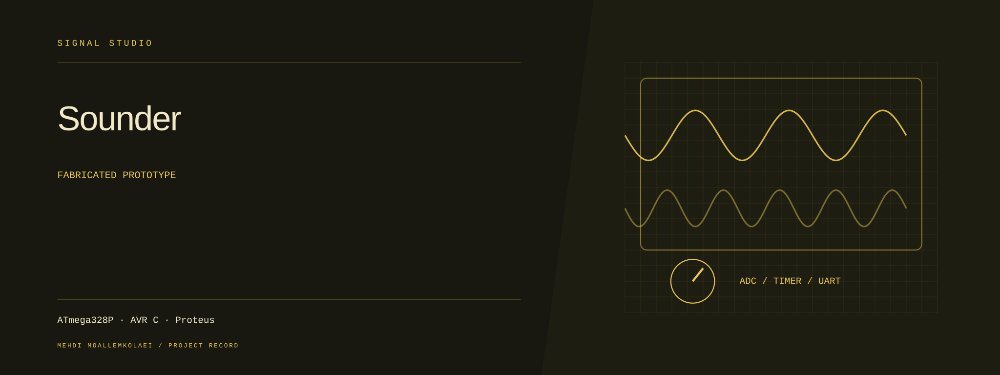

# Sounder

**Generate a variable-frequency signal with an ATmega328P circuit and firmware.**

ATmega328P · AVR C · Proteus · PCB

[Project record](#bench-card) · [Design](portfolio/DESIGN.md) · [Setup](portfolio/SETUP.md) · [Validation](portfolio/VALIDATION.md) · [Evidence](portfolio/EVIDENCE.md)

<!-- project-navigation:start -->

  
  
  
  

<strong>Fabricated prototype</strong> &nbsp; / &nbsp; Engineering &nbsp; / &nbsp; <a href="https://ace-alch.github.io/">Mehdi's portfolio</a>

<!-- project-navigation:end -->

## Bench card

| Item | Record |
| :-- | :-- |
| Project type | Fabricated prototype |
| Field | Engineering |
| Material in this package | Existing repository inspected |
| Documentation review | 17 November 2026 |

## The build

Generate a variable-frequency signal with an ATmega328P circuit and firmware. The documentation separates the stated project scope, inspected artifacts and future work. A listed feature is not a new test result.

### Subsystems

- Potentiometer
- ADC
- Timer1
- Sound output
- UART

## Open the bench notes

1. Read the [design record](portfolio/DESIGN.md) for the system elements and boundaries.
2. Follow the [setup record](portfolio/SETUP.md) for available entry points.
3. Use the [validation plan](portfolio/VALIDATION.md) to record reproducible results.
4. Check the [evidence register](portfolio/EVIDENCE.md) before reusing claims.

## Technical limits

The source requests 50–1000 Hz and defaults to 440 Hz. Timer1 uses no prescaler and a 16-bit compare register. At 16 MHz, a 50 Hz target requires 159999, which exceeds 65535. Thus the full requested range is not established by this implementation. Verify the output with a scope before claiming the range.

## Project preview

This image is an existing repository artifact. It is not evidence of a new test.

<strong>Browse source files and project artifacts</strong>

| Path | Type |
| :-- | :-- |
| [Code & Sim/README.md](https://github.com/Ace-Alch/Sounder/blob/main/Code%20%26%20Sim/README.md) | .md |
| [Code & Sim/Simulation/100%.png](https://github.com/Ace-Alch/Sounder/blob/main/Code%20%26%20Sim/Simulation/100%25.png) | .png |
| [Code & Sim/Simulation/25%.png](https://github.com/Ace-Alch/Sounder/blob/main/Code%20%26%20Sim/Simulation/25%25.png) | .png |
| [Code & Sim/Simulation/50%.png](https://github.com/Ace-Alch/Sounder/blob/main/Code%20%26%20Sim/Simulation/50%25.png) | .png |
| [Code & Sim/Simulation/75%.png](https://github.com/Ace-Alch/Sounder/blob/main/Code%20%26%20Sim/Simulation/75%25.png) | .png |
| [Code & Sim/Simulation/README.md](https://github.com/Ace-Alch/Sounder/blob/main/Code%20%26%20Sim/Simulation/README.md) | .md |
| [Code & Sim/Simulation/simulation.mp4](https://github.com/Ace-Alch/Sounder/blob/main/Code%20%26%20Sim/Simulation/simulation.mp4) | .mp4 |
| [Code & Sim/main.c](https://github.com/Ace-Alch/Sounder/blob/main/Code%20%26%20Sim/main.c) | .c |
| [Fabrication/Back.jpg](https://github.com/Ace-Alch/Sounder/blob/main/Fabrication/Back.jpg) | .jpg |
| [Fabrication/Components.jpg](https://github.com/Ace-Alch/Sounder/blob/main/Fabrication/Components.jpg) | .jpg |
| [Fabrication/Front.jpg](https://github.com/Ace-Alch/Sounder/blob/main/Fabrication/Front.jpg) | .jpg |
| [Fabrication/README.md](https://github.com/Ace-Alch/Sounder/blob/main/Fabrication/README.md) | .md |

See the [complete source inventory](portfolio/SOURCE-INVENTORY.md) for all inspected file paths.

## Verification backlog

- [ ] Editable Proteus and PCB source
- [ ] BOM and board revision
- [ ] Oscilloscope measurements
- [ ] Timer range verification

## Credits and reuse

Project record: Mehdi Moallemkolaei. Specific third-party and course contributions must retain their original notices.

Existing license terms remain in effect. This package does not grant a new license over source code, course material, models or datasets. See [reuse and contribution notes](portfolio/CONTRIBUTIONS.md).

---

[Visual design notes](portfolio/VISUAL-DESIGN.md) · [Design tokens](portfolio/design-tokens.json)
