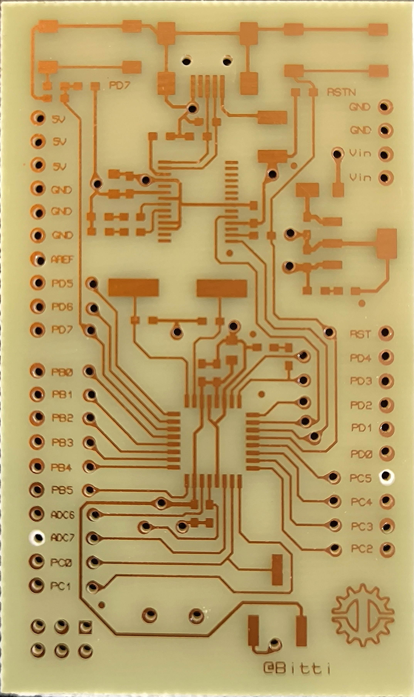
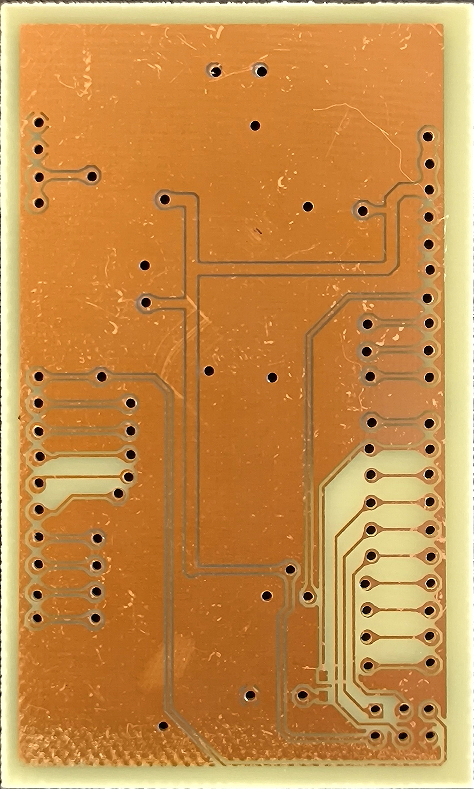

# Sounder

**A fabricated ATmega328P sound generator with a potentiometer input and a timer-driven square-wave output.**

[Open the interactive signal bench](https://ace-alch.github.io/apps/exhibits/sounder/) · [Read the firmware](Code%20%26%20Sim/main.c) · [See the simulation](Code%20%26%20Sim/Simulation/simulation.mp4)

<table>
<tr>
<td width="55%"></td>
<td width="45%"></td>
</tr>
<tr><td><b>Component side</b></td><td><b>Reverse side</b></td></tr>
</table>

## From a turn of the knob to a square wave

The ADC reads the potentiometer. The firmware maps the reading to a requested frequency and writes a compare value to Timer1. The compare interrupt toggles PB2 when the system is active and unpaused. Timer0 controls LED brightness through PWM. The UART handler accepts `+` and `-` requests. The active ADC loop can overwrite that adjustment.

| Examine | Original material |
| --- | --- |
| Circuit | [Schematic design](Schematic%20Design/README.md) |
| Board | [PCB layout](PCB%20Design/README.md) and [fabrication photos](Fabrication/README.md) |
| Firmware | [AVR C source](Code%20%26%20Sim/main.c) and [requirements](Code%20%26%20Sim/README.md) |
| Simulation | [Screenshots and video](Code%20%26%20Sim/Simulation/README.md) |

## What the timer actually produces

The firmware uses a 16 MHz clock, a prescaler of 1, and a 16-bit compare register. A 50 Hz request requires a compare value of 159,999. The register stores 28,927 after truncation. The corresponding ideal output is **276.55 Hz**. The lowest whole-number request that fits is **123 Hz**.

| Requested | Stored in OCR1A | Ideal output from stored value |
| ---: | ---: | ---: |
| 50 Hz | 28,927 | 276.55 Hz |
| 123 Hz | 65,039 | 123.00 Hz |
| 440 Hz | 18,180 | 440.02 Hz |
| 1,000 Hz | 7,999 | 1,000.00 Hz |

The table comes from a host test of the original compare routine. The test also checks that the original interrupt toggles PB2 only when the system is active and unpaused. Physical frequency, ISR latency, and board behavior need oscilloscope measurements.

Run the check from the repository root with Python 3 and a host C compiler:

```sh
python tools/check_timer.py
```

[Open the validation notes](portfolio/VALIDATION.md) · [Browse the complete source inventory](portfolio/SOURCE-INVENTORY.md)
