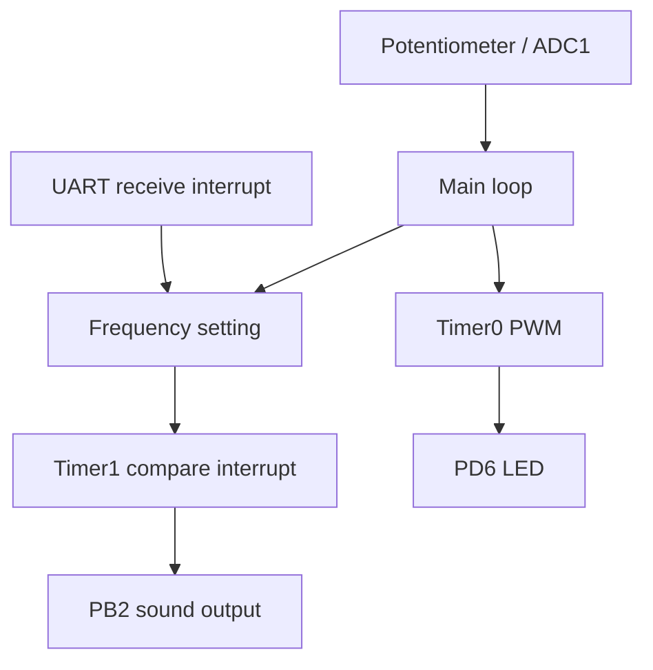

# Sounder: design record

## Purpose

Generate a variable-frequency signal with an ATmega328P circuit and firmware.

## Elements

| Element | Documentation boundary |
| :-- | :-- |
| Potentiometer | Included in the stated project scope. Implementation details need the corresponding source or design file. |
| ADC | Included in the stated project scope. Implementation details need the corresponding source or design file. |
| Timer1 | Included in the stated project scope. Implementation details need the corresponding source or design file. |
| Sound output | Included in the stated project scope. Implementation details need the corresponding source or design file. |
| UART | Included in the stated project scope. Implementation details need the corresponding source or design file. |

## Technical stack

- ATmega328P
- AVR C
- Proteus
- PCB

## Boundaries

The source requests 50�1000 Hz and defaults to 440 Hz. Timer1 uses no prescaler and a 16-bit compare register. At 16 MHz, a 50 Hz target requires 159999, which exceeds 65535. Thus the full requested range is not established by this implementation. Verify the output with a scope before claiming the range.

## Decisions to recover

Record each design decision with its problem, selected option, rejected options and supporting artifact. Keep the original model or source revision with the record.

## Inspected firmware design

| Function | Source behavior |
| :-- | :-- |
| ADC | Reads ADC1 with AVCC reference |
| Sound output | Toggles PB2 in the Timer1 compare interrupt |
| Timer1 | CTC mode; no prescaler |
| LED PWM | Timer0 fast PWM on PD6 |
| UART | 9600 baud; receives `+` and `-` for 10 Hz changes |
| Clock setting | Source declares 16 MHz |

For a toggled output, the intended frequency is `F_CPU / (2 * (OCR1A + 1))` with prescaler 1. At 16 MHz, the compare register can reach 65535. This gives an approximate lower bound of 122.07 Hz. A 50 Hz request exceeds this register range. A prescaler change needs matching arithmetic and measurements.

The `F_CPU` define appears after the delay header. Define it in the build flags before the header is processed. These findings are source-inspection results, not hardware measurements.
